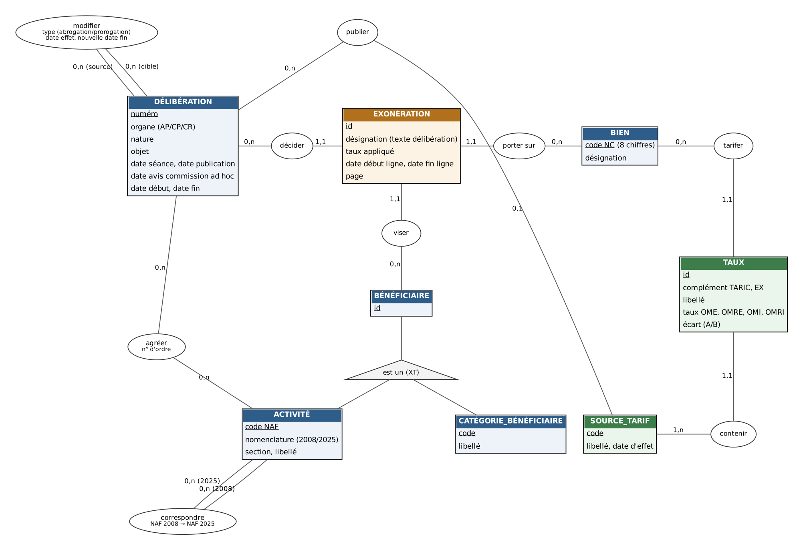

# Modèle de données

## Entités

On reprend les entités du sujet et on en ajoute quatre.

| Entité | Table | Contenu |
|---|---|---|
| Délibération | `deliberation` | numéro, organe, nature, objet, dates (séance, publication, avis, début, fin) |
| Bénéficiaire | `beneficiaire` | une activité **ou** une catégorie |
| Bien | `bien` | code NC (8 chiffres), désignation |
| Activité | `activite` | code NAF, nomenclature (2008 / 2025), libellé |
| Taux | `taux` | taux OME, OMRE, OMI, OMRI d'un bien dans un tarif |
| Exonération | `exoneration` | un bien + un bénéficiaire + une délibération, avec le taux appliqué |
| *Ajout* | `modification` | une délibération qui en abroge ou en proroge une autre |
| *Ajout* | `source_tarif` | le tarif utilisé (tarif 2024, puis CP/26-606 au 01/11/2026) |
| *Ajout* | `categorie_beneficiaire` | bénéficiaire sans code NAF (établissements de santé) |
| *Ajout* | `agrement`, `correspondance_naf` | activités agréées (annexe II), passage NAF 2008 → 2025 |

## MLD

- deliberation (**numero**, organe, nature, objet, date_seance, date_publication, date_avis_commission, date_debut, date_fin, fichier)
- modification (**id**, #source, #cible, type, date_effet, nouvelle_date_fin)
- bien (**code_nc**, designation)
- activite (**code_naf**, nomenclature, section, libelle)
- categorie_beneficiaire (**code**, libelle)
- beneficiaire (**id**, #code_naf, #categorie)
- agrement (**#numero, #code_naf**, ordre)
- correspondance_naf (**#naf_2008, #naf_2025**, #source)
- exoneration (**id**, #numero, #code_nc, #beneficiaire_id, designation, taux_applique, date_debut_ligne, date_fin_ligne, page)
- source_tarif (**code**, libelle, date_effet, #numero)
- taux (**id**, #source, #code_nc, complement, ex, libelle, ome, omre, omi, omri, ecart)

## Nos choix

**Exonération est une entité, pas une simple association.** Elle a ses propres attributs (taux, dates), et le même trio bien / activité / délibération peut revenir deux fois. Exemple : la CP/26-599 vise le code 23.61Z jusqu'au 31/12/2026, puis 23.61Y à partir du 01/01/2027.

**Les bénéficiaires sans NAF.** La CP/25-456 vise les établissements de santé, sans code NAF. Un bénéficiaire est donc soit une activité, soit une catégorie, jamais les deux (contrainte CHECK).

**Les abrogations et les prorogations.** La table `modification` relie deux délibérations. On garde la date de fin d'origine. La vue `v_deliberation_vigueur` calcule la date de fin réelle et la date d'abrogation.

**Le lien avec le tarif.** Le tarif vient de Karudata, les exonérations de la Région : le seul point commun est le code NC. Le taux est daté par `source_tarif`, ce qui permet d'appliquer la CP/26-606 à partir du 01/11/2026.

**Formats.** NC sur 8 chiffres sans espace, NAF au format `01.13Z`, dates `AAAA-MM-JJ`. Quand une CP ne donne pas de date de début, on prend sa date de publication.

## Requête demandée

« Pour l'activité X, le bien Y importé à la date D est-il exonéré, par quelle délibération et à quel taux ? » : voir `db/requete_unique.sql`.

Aucune ligne renvoyée = pas d'exonération à cette date.
